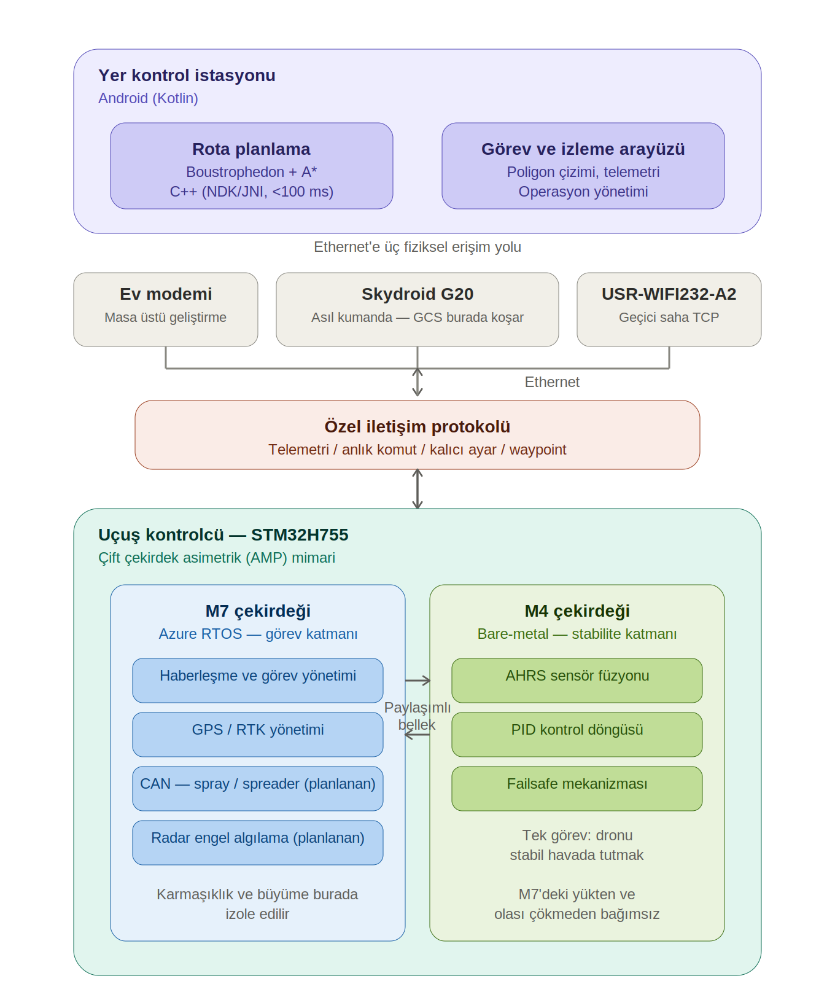
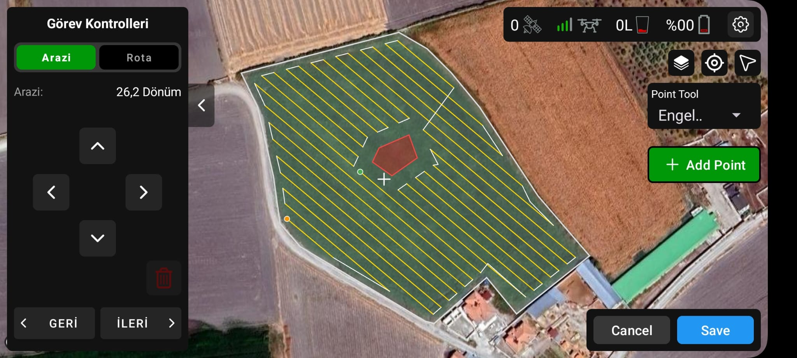

# Otonom Zirai Dron Sistemi

Tarım arazilerinde otonom ilaçlama/gözlem uçuşu için geliştirilen uçtan uca bir dron sistemi: uçuş kontrolcü, yer kontrol istasyonu ve aralarındaki özel iletişim protokolü.

Sistem mimarisi, kontrol algoritmaları ve tüm teknik kararlar tek kişilik bir geliştirme süreciyle alınmıştır; geliştirme sürecinde yapay zeka destekli araçlardan yararlanılmıştır. Proje aktif geliştirme aşamasındadır; sıradaki adım PID kontrolcüsünün yazılması ve test setup'ında PID tune çalışmalarıdır.

> Bu depo yalnızca proje dokümantasyonu içindir. Kaynak kod bu aşamada paylaşılmamaktadır.

## Genel bakış

Sistem üç ana bileşenden oluşur:

1. **Uçuş kontrolcü** — STM32H755 üzerinde, çift çekirdekli asimetrik multiprocessing (AMP) mimarisiyle çalışan gerçek zamanlı yazılım.
2. **Yer kontrol istasyonu (GCS)** — Android üzerinde arazi/engel tanımlama, tam kapsama rota planlama ve uçuş izleme sağlayan uygulama.
3. **Özel iletişim protokolü** — MAVLink yerine, zirai operasyonlara özel olarak tasarlanmış paket ve komut seti.

## Sistem mimarisi

## Uçuş kontrolcü: çift çekirdek mimari

Uçuş kontrolcü, görev karmaşıklığını uçuş stabilitesinden ayırmak amacıyla STM32H755'in çift çekirdekli (Cortex-M7 + Cortex-M4) yapısı üzerine, asimetrik multiprocessing (AMP) modeliyle tasarlanmıştır.

**M7 çekirdeği — görev katmanı (Azure RTOS / ThreadX, NetXDuo):**
- Haberleşme ve waypoint yönetimi
- GPS/RTK yönetimi
- CAN bus üzerinden spray/spreader kontrolü *(planlanan)*
- Radar tabanlı engel algılama ve kaçınma *(planlanan)*

**M4 çekirdeği — stabilite katmanı (bare-metal, 1 kHz):**
- IMU/manyetometre sensör füzyonu (AHRS)
- PID kontrol döngüsü
- Failsafe mekanizması

İki çekirdek arasındaki veri alışverişi paylaşımlı bellek üzerinden yürütülür; bu sayede M7 tarafındaki işlem yükü veya olası bir hata M4'ün kontrol döngüsünü etkilemez.

Bu ayrımın gerekçesi hem teknik hem operasyoneldir. Teknik olarak, tek çekirdekte çalışan 400 Hz'lik PID döngüsünün RTOS altında Ethernet haberleşmesi tarafından bloklanması sorun oluşturuyordu. Operasyonel olarak ise, sisteme sürekli eklenecek yeni yeteneklerin (RTK, engel algılama, spreyleme kontrolü vb.) getireceği karmaşıklığın, dronun havada kalma yeteneğinden fiziksel olarak izole edilmesi hedeflenmiştir — sistemin herhangi bir noktasında oluşabilecek bir gecikme veya çökme, stabilite ve failsafe katmanını etkilememelidir.

## Haberleşme altyapısı

Uçuş kontrolcüsünde ana veri hattı olarak Ethernet tercih edilmiştir. Bu tercih, mevcut ihtiyacın yanı sıra sistemin büyüme kapasitesini de gözetir: ileride eklenmesi planlanan repeater ve RTK base station gibi bileşenlerin de TCP/IP üzerinden aynı ağa dahil edilmesi hedeflenmektedir. *(Joystick ve fiziksel kontroller için ayrı bir SBUS hattı kullanılmaktadır.)*

Sahada bu Ethernet arayüzüne üç farklı fiziksel yoldan erişilebilir:

| Yol | Kullanım amacı |
|---|---|
| Ev modemi | Masa üstü geliştirme ortamı |
| Skydroid G20 | Asıl kullanılacak kumanda. Yer kontrol istasyonu uygulaması bu kumanda üzerinde çalışacak; kumandanın alıcısındaki Ethernet portu üzerinden uçuş kontrolcüsüne doğrudan bağlanılır. |
| USR-WIFI232-A2 | Karta entegre Wi-Fi modülü. Sahada, kumanda olmadan geçici bir TCP bağlantısı kurmak amacıyla kullanılır; test ve kalibrasyon sırasında fiziksel hareket serbestliği sağlar. |

## Özel iletişim protokolü

MAVLink, spray/spreader gibi zirai operasyonlara özel parametreleri desteklemediği için özel bir paket yapısı ve komut seti tasarlanmıştır. Protokol dört veri kategorisini ayırır:

| Kategori | Amaç |
|---|---|
| Telemetri | Uçuş sırasında sürekli akan durum verisi |
| Anlık komut | Tek seferlik, doğrudan yürütülen komutlar (spreyleme/spreader gibi zirai operasyon komutları dahil) |
| Kalıcı ayar | Flash belleğe yazılan yapılandırma parametreleri |
| Waypoint | GCS'ten uçuş kontrolcüsüne rota dosyasının iletilmesi ve dron tarafından tamamlanan waypoint'lerin anlık olarak bildirilmesi |

## Yer kontrol istasyonu ve rota planlama

Rota planlama modülü, poligon olarak tanımlanan arazi ve engel sınırlarını boustrophedon hücre ayrıştırma yöntemiyle alt bölgelere ayırır, ardından A* algoritmasıyla alt bölgeler arasında en kısa zigzag geçiş rotasını üretir.

Sistem ilk olarak Kotlin ve JTS ile geliştirilmiş, ardından performans gereksinimleri nedeniyle hesaplama katmanı NDK/JNI üzerinden C++'a taşınmıştır. Bu geçişle rota üretim süresi 100 ms'nin altına indirilmiş, engel sayısından bağımsız olarak gecikmesiz harita yükleme ve gerçek zamanlı rota açısı değişimi sağlanmıştır.

## Donanım

- Gövde tasarımı Fusion 360 ile yapılmış, 3D baskı ile üretilmiştir.
- Uçuş kontrolcü kartı: STM32H755 (çift çekirdek Cortex-M7 + Cortex-M4, Ethernet destekli).

## Kullanılan teknolojiler

- **Gömülü:** STM32 (H7), C, Azure RTOS (ThreadX/NetXDuo), bare-metal geliştirme, IMU/GPS entegrasyonu, PID kontrol
- **Yazılım:** Kotlin (Android), C/C++ (NDK/JNI), algoritma tasarımı (A\*, path planning), protokol tasarımı
- **Donanım:** Fusion 360, 3D baskı, devre kurulumu

## Durum

Proje aktif geliştirme aşamasındadır (2025'ten beri, ~8 ay). Sıradaki adım PID kontrolcüsünün yazılması ve test setup'ında PID tune çalışmalarıdır.
